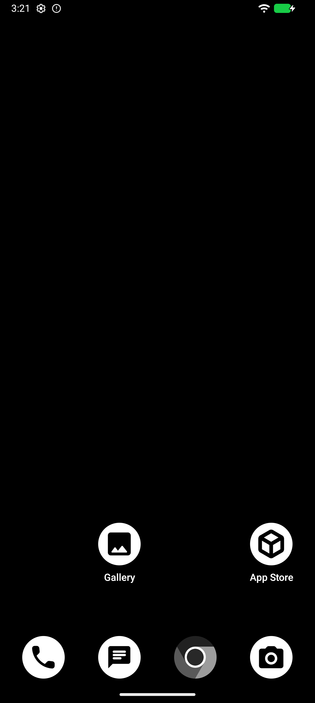
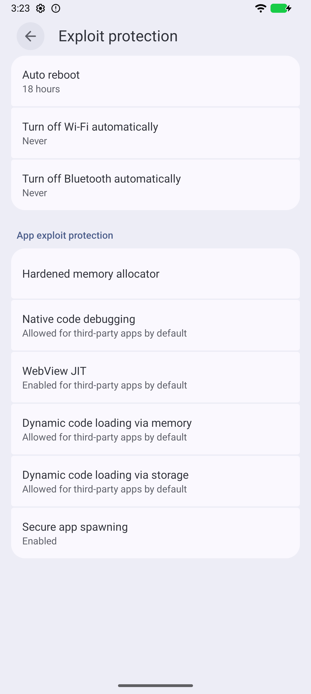

# GrapheneOS Community Emulator Images Repository

> [!IMPORTANT]
> This is an independent community project. It is not affiliated with or endorsed by GrapheneOS. The emulator is for local development and app testing—not production-device security evaluation.

A repository for community-built GrapheneOS SDK emulator images.

I was building an AOSP platform app in my spare time and couldn't find a prebuilt image online. GrapheneOS documents how to build its SDK emulator target but [does not publish official emulator images](https://discuss.grapheneos.org/d/7150-virtual-machine-with-gos-as-guest-os/2), so I built one myself following their documentation.

Building one is honestly kind of a pain in the ass, so this repository shares prebuilt images with other developers and documents a simpler process for creating new ones.

This repository includes:

- A prebuilt Android Emulator `sysdir` compiled from official GrapheneOS sources.
- Setup and launch scripts for Windows, Linux, and Intel macOS.
- A scripted Windows + WSL build pipeline for producing future images.
- Boot validation, per-file hashes, release checksums, and exact source provenance.

> [!NOTE]
> This is a custom system directory, not a complete AVD or an Android Studio SDK package. You supply a normal x86-64 phone AVD; the launcher uses `-sysdir` to load the custom system files at runtime.

## Current release

The current release is `2026091000`. The earlier `2026062800` release remains available.

### Current release `2026091000`

| Field | Value |
|---|---|
| Upstream source | GrapheneOS tag `2026091000` |
| Manifest commit | `ac9f2fdf0badebea2f6ac6c3e93b125aba02116a` |
| Android | 17 / API 37 |
| Security patch | 2026-09-01 |
| Build ID | `CP2A.260605.016` |
| Target | `sdk_phone64_x86_64-userdebug` |
| Architecture | x86-64 |
| Validated host | Windows x86-64 |
| Boot validated | 2026-09-18 |
| Sysdir per-file manifest SHA-256 | `33e2ed8e6bcdafc9676d83f67fa209cac8c217f0470121f998bb9d46d7e7601b` |

The upstream tag signature verified as good against the published ED25519 key for `contact@grapheneos.org`. Validation ran on the dedicated serial `emulator-5584` with `-wipe-data` and `-no-snapshot`: the image booted to `sys.boot_completed=1`, reported `sdk_phone64_x86_64-userdebug`, exposed 17 GrapheneOS and Vanadium packages, and produced no guest kernel panic. The exact boot-tested sysdir is 12 files totalling 6.18 GB.

Release assets and their SHA-256 digests:

```
96f8bc6d045ebf23e96f5ac7a3a30f50aef267dd6cca0070b25a8b3717dcee16  grapheneos-community-emulator-sdk_phone64_x86_64-2026091000.zip
337d29c8ad978d833072ed16afbdbc7664b949a60857948502cc777f862b2eee  grapheneos-community-emulator-sdk_phone64_x86_64-2026091000.zip.part1
202b3867f8aa3dabf8f7bbd155e58ecb2e0718fc7b5ab8eb3eb334d7ac0603f6  grapheneos-community-emulator-sdk_phone64_x86_64-2026091000.zip.part2
```

### Previous release `2026062800`

| Field | Value |
|---|---|
| Upstream source | GrapheneOS tag `2026062800` |
| Manifest commit | `ad69afb5ac59ea130ac092e778b37ae2b7158df7` |
| Android | 17 / API 37 |
| Security patch | 2026-06-05 |
| Target | `sdk_phone64_x86_64-userdebug` |
| Architecture | x86-64 |
| Validated host | Windows x86-64 |

The image booted to `sys.boot_completed=1`, reported the expected target, exposed GrapheneOS and Vanadium packages, and produced no guest kernel panic. The release metadata records the final validation timestamp and automation commit.

## Screenshots

Both screenshots come from a freshly wiped emulator with no account or personal app data.

<div align="center">
  <table>
    <tr>
      <th>Clean emulator home</th>
      <th>GrapheneOS exploit-protection settings</th>
    </tr>
    <tr>
      <td align="center"></td>
      <td align="center"></td>
    </tr>
  </table>
</div>

## Build validation and integrity checks

The release verifies the upstream GrapheneOS manifest tag, records its exact commit, boot-tests the sysdir, and hashes every boot-tested file. Packaging fails if any current file differs from that validation manifest. The final ZIP and every numbered part are hashed again.

These checks show that the published bytes match the bytes this project boot-tested. They do not prove equivalence to an official emulator binary because GrapheneOS does not publish one. See [Build provenance and integrity validation](docs/provenance.md) for the exact trust boundary and stronger future options.

## Before you start

You need:

1. An x86-64 computer. Apple silicon and other ARM64 hosts are not supported by this image.
2. Android Studio or the Android SDK with `emulator` and `adb` installed.
3. A normal x86-64 phone AVD created in Android Studio Device Manager. Any short name is fine; examples below use `GrapheneOS_Base`.
4. Roughly 7 GiB free after extracting the joined archive.

Windows is validated. Linux x86-64 and Intel macOS launchers are experimental until tested on real hosts.

## Download and verify

Download every numbered ZIP part, `SHA256SUMS.txt`, and `JOIN-INSTRUCTIONS.txt` for the release you want from the GitHub Release page. The release notes also keep the exact join, verification, and extraction commands visible beside the downloads.

Use the exact filenames and commands in the downloaded `JOIN-INSTRUCTIONS.txt`. For the current release `2026091000`, the process is:

Windows PowerShell:

```powershell
$name = 'grapheneos-community-emulator-sdk_phone64_x86_64-2026091000'
Get-FileHash "$name.zip.part1", "$name.zip.part2" -Algorithm SHA256
cmd /c copy /b "$name.zip.part1+$name.zip.part2" "$name.zip"
Get-FileHash "$name.zip" -Algorithm SHA256
```

Linux or macOS:

```bash
name=grapheneos-community-emulator-sdk_phone64_x86_64-2026091000
sha256sum "$name.zip.part1" "$name.zip.part2" # Linux
cat "$name.zip.part1" "$name.zip.part2" > "$name.zip"
sha256sum "$name.zip"
```

On macOS, use `shasum -a 256` to compare hashes manually because `sha256sum` is not installed by default. After joining, verify the complete ZIP hash listed in `SHA256SUMS.txt`, then extract it.

## Android Studio compatibility

These images are compatible for use with Android Studio. Launch the custom image with this repository's script, then Android Studio discovers it through ADB as a normal running emulator. Select it as the deployment target to install, run, and debug apps.

The image is intentionally not installed over an Android SDK system image. Starting the base AVD directly from Device Manager therefore uses its original system image; start the GrapheneOS-backed instance with `launch-windows.ps1`, `launch-linux.sh`, or `launch-macos.sh` first.

## Set up and run

Run the setup script from the extracted release directory. It checks CPU architecture, the sysdir, Android SDK tools, and the requested AVD before saving the AVD choice locally. Automation agents can also read [AGENTS.md](AGENTS.md) for repository-specific setup and safety instructions.

### Windows

```powershell
pwsh -NoProfile -File .\install\setup-windows.ps1 -AvdName GrapheneOS_Base
pwsh -NoProfile -File .\install\launch-windows.ps1
```

Windows PowerShell 5.1 also works by replacing `pwsh` with `powershell`.

### Linux x86-64

```bash
chmod +x install/*.sh
./install/setup-linux.sh GrapheneOS_Base
./install/launch-linux.sh
```

### macOS Intel

```bash
chmod +x install/*.sh
./install/setup-macos.sh GrapheneOS_Base
./install/launch-macos.sh
```

Set `ANDROID_SDK_ROOT` if the SDK is not in its platform-default location. Each launcher accepts extra emulator arguments after `--`, for example `./install/launch-linux.sh -- -no-window -no-audio`.

## Build from source

The full source build is currently automated for Windows hosts using Ubuntu under WSL2:

```powershell
$Tag = 'YYYYMMDDNN' # replace with a verified ten-digit GrapheneOS release tag
.\scripts\build-grapheneos-emulator.ps1 -GrapheneOsTag $Tag
```

This temporarily increases WSL memory and swap, syncs the selected GrapheneOS tag, builds `sdk_phone64_x86_64-userdebug`, packages QEMU-specific images, validates a headless boot, restores the original WSL configuration, and launches the visible emulator.

Useful commands:

```powershell
.\scripts\build-grapheneos-emulator.ps1 -Status
.\scripts\build-grapheneos-emulator.ps1 -Validate
.\scripts\build-grapheneos-emulator.ps1 -Finalize
.\scripts\build-grapheneos-emulator.ps1 -Restore
.\scripts\package-grapheneos-emulator-release.ps1
```

### Borrowed host resources

A build is expensive and temporary. It needs roughly 200 GB for the source checkout plus 100–150 GB for build output, most of the host RAM, every CPU thread, and a machine that does not fall asleep.

The build refuses to start without the disk space to finish, measuring both the WSL filesystem and the host volume backing the WSL disk. Tune the bar with `-MinFreeGB` (full build, default 300) and `-MinFreeResumeGB` (resume, default 150), or bypass it deliberately with `-SkipSpaceCheck`. Sleep-on-idle is disabled for the duration and the previous timeout is recorded so it can be put back.

`-Restore` gives everything back: the original `.wslconfig`, the prior sleep timeout, the whole WSL build tree, and any scheduled build task. It prints its plan and changes nothing unless you pass `-Force`, refuses to run while a build is in progress, and reports the disk space it actually reclaimed rather than assuming.

```powershell
.\scripts\build-grapheneos-emulator.ps1 -Restore -GrapheneOsTag $Tag           # dry run
.\scripts\build-grapheneos-emulator.ps1 -Restore -Force -GrapheneOsTag $Tag    # apply
```

Add `-Compact` to compact the WSL disk image from an elevated session, or `-DisableSparse` to turn sparse mode back off. Use `-Reclaim` instead when you want to keep the source checkout for a rebuild. See [cleanup](docs/current-status-and-cleanup.md) for the full picture.

The source tree is built inside WSL's Linux filesystem, never `/mnt/c`. Compiled images and release archives live outside the repository and are never committed.

The default output root is `C:\Android\grapheneos-emulator`. Override it with `-OutputRoot` or the `GRAPHENEOS_EMULATOR_ROOT` environment variable. `-AndroidSdkRoot` / `ANDROID_SDK_ROOT` and `-Distro` / `GRAPHENEOS_WSL_DISTRO` provide the corresponding host overrides.

### Creating a new image

Maintainers should follow the complete [new-image workflow](docs/create-new-emulator-image.md). It covers choosing and signature-verifying a current or future upstream tag, isolating retained state from older tags, building, validation, repository checks, provenance, packaging, independent checksum verification, privacy review, and the approval boundary before publishing.

A manual [cloud build workflow](.github/workflows/build-emulator.yml) is included for future releases. It never runs on a push, pull request, or schedule and never publishes a GitHub Release. It requires a separately provisioned, sufficiently large Windows x86-64 cloud runner labeled `grapheneos-cloud-builder`, with WSL2, Ubuntu, Android SDK emulator tools, hardware virtualization, and GrapheneOS build dependencies already configured. It builds, validates, packages, and uploads a temporary release candidate for human review.

The Android Emulator needs the QEMU-specific GrapheneOS images:

- `system-qemu.img` packaged as `system.img`
- `vendor-qemu.img` packaged as `vendor.img`
- `ramdisk-qemu.img` packaged as `ramdisk.img`

Generic partition images can panic during first-stage init because they do not carry the expected emulator block-device layout.

## Repository map

- `install/`: consumer setup and launch scripts.
- `scripts/`: source build, validation, packaging, and release tooling.
- `tests/`: unit and contract checks that do not perform a full OS build.
- `.github/workflows/verify.yml`: fast Windows and Linux checks; never a multi-hour OS build.
- `.github/workflows/build-emulator.yml`: manual-only build on a dedicated large cloud runner; never runs automatically or publishes a release.
- `docs/project-design.md`: naming, research, platform policy, and release design.
- `docs/build-and-share-compiled-grapheneos-emulator.md`: maintainer release guide.

## Tests

```powershell
pwsh -NoProfile -File .\tests\build-progress.tests.ps1
pwsh -NoProfile -File .\tests\orchestrator-contract.tests.ps1
pwsh -NoProfile -File .\tests\repository-contract.tests.ps1
wsl -d Ubuntu -- bash tests/gos-build-progress.test.sh
wsl -d Ubuntu -- bash tests/install-scripts.test.sh
```

## Project status and safety

GrapheneOS officially documents `sdk_phone64_x86_64` as a development-only target that does not receive full monthly security updates or provide all baseline security features. Read the [official build documentation](https://grapheneos.org/build#build-targets) and [trademark guidance](https://grapheneos.org/faq#trademark).

These emulator images do not have a supported automatic update path. Replace an installed image with a newer, separately downloaded and verified release.

Use a disposable emulator profile, and never store production credentials in it.

### Project status

- [x] Release `2026062800` image boot-validated on Windows x86-64.
- [x] Upstream tag `2026091000` image built and boot-validated on Windows x86-64.
- [x] Upstream tag `2026091000` image packaged, checksummed, and published.
- [x] Linux x86-64 and Intel macOS launch scripts included.
- [x] Manual future-build workflow for a separately configured large cloud runner.
- [ ] Linux launcher validated on a real Linux host.
- [ ] Intel macOS launcher validated on a real Intel Mac.
- [ ] Native ARM64 image and host support.

## Donations

Building and validating these images eats a lot of CPU time, RAM, storage, and cloud-runner hours. Donations help us keep current GrapheneOS emulator images available and pay for the hardware and hosting needed to build them properly.

<p align="center">
  <a href="monero:82xbMgjq3gNT6DnqEMpMsd1Xi7D8usxS53imTpmoMtymVqQYrSDY2626AreA4PJtD1JaJMmAuk1bNJvHkLRNieT1CFgiG99">
    
  </a>
  &nbsp;&nbsp;
  <a href="bitcoin:bc1q7uu9vddheha6n2ef5a2jx5ajmf5hkf5mnsge26">
    
  </a>
</p>

## License

To the extent repository contributors own the material, this repository's original tooling and documentation are available under the [GNU General Public License v3.0](LICENSE).

> [!NOTE]
> **Licensing boundary:** GPL-3.0 covers only original repository material owned by its contributors. Bundled Android, GrapheneOS, Android Emulator, emulator images, and other third-party components retain their respective upstream licenses and notices; this repository's GPL license does not relicense them.
